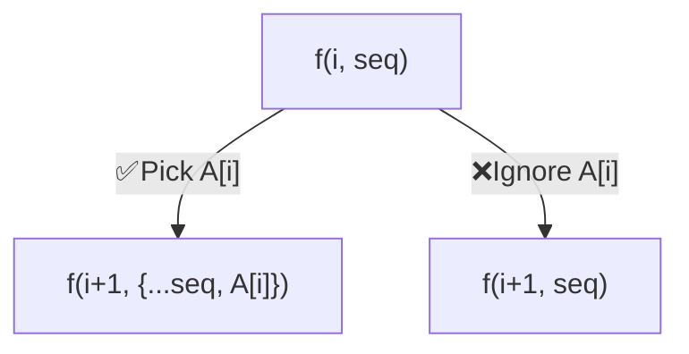
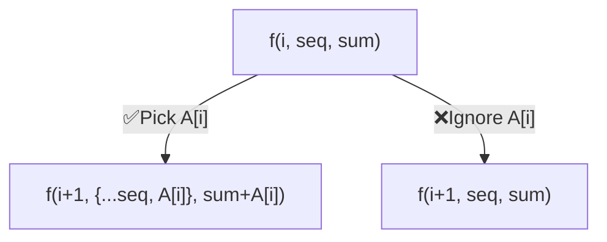

**Contents**:

- [Identifying a Recursion problem](#identifying-a-recursion-problem)
- [Example: Generate ALL Subsequences](#example-generate-all-subsequences)
- [Things to note](#things-to-note)
  - [Restoring State after a Recursive call finishes](#restoring-state-after-a-recursive-call-finishes)
  - [Order of Operations matter](#order-of-operations-matter)
- [Variant: ALL Subsequences whose SUM equals Target](#variant-all-subsequences-whose-sum-equals-target)
- [Variant: ANY Subsequence whose SUM equals Target](#variant-any-subsequence-whose-sum-equals-target)
- [Variant: COUNT ALL Subsequences whose SUM equals Target](#variant-count-all-subsequences-whose-sum-equals-target)

## Identifying a Recursion problem

When we are generating **ALL possible cases/solutions** for a problem, it results in a tree-like structure, commonly known as **State-space Tree** or [**Decision Tree**](https://en.wikipedia.org/wiki/Decision_tree)

Each node represents a **partial/complete solution** (leaf nodes usually form a complete solution and intermediate nodes being partial solutions). These nodes are all the different possible **states** and each branch edge is a **transition** between two states.

This transition can be thought of as a **decision** made at a state. The number of transitions i.e. **branching** at a state would depend on the number of actions possible at that state

**Base case**: It is the **most-trivial** possible state generally indicating we have reached the end of a recursive exploration path. This prevents infinite nesting of recursive calls so it's quite a crucial component

To illustrate, consider an example:

## Example: Generate ALL Subsequences

> Print **ALL subsequences** of an array `A[] = {5,9,8}` (assuming **unique** elements)

Here, we are traversing one element at a time and at each element, we decide either to:

- include it in ongoing sequence i.e. PICK it ✅
- NOT include it in ongoing sequence i.e. IGNORE it ❌

The tracker variable passed within functions is the **index** `i` of current element. Also, we would need to track the **sequence formed** at each point of traversal which is `seq`. The decision branching at each index `i` can be represented as below:



The **base-case** would be when current index is **out of bounds of array** i.e. when current index equals length of array. The recursion tree generated in the process of traversing all possible solutions is shown below. Note the red boxes are the recursive calls being terminated the base case


```cpp title="Print ALL Subsequences"
// Recursive helper function
void func (
    const size_t idx,
    vector<int> &seq,
    vector<vector<int>> &ans,
    const vector<int> &A
) {
    if (idx == A.size()) {      // Base Case: Index out of bounds
        ans.emplace_back(seq);  // Current sequence is complete solution, no further calls
        return;
    }

    seq.emplace_back(A[idx]);    // PICK (insert current element into sequence)
    func(idx + 1, seq, ans, A);  // Next recursive call considering PICKED

    seq.pop_back();              // IGNORE (remove current element you had inserted earlier)
    func(idx + 1, seq, ans, A);  // Next recursive call considering IGNORED
}

vector<vector<int>> getAllSubsequences (const vector<int> &A) {
    vector<vector<int>> ans;
    vector<int> seq;
    size_t idx = 0;

    // First starting recursive call
    func(idx, seq, ans, A);

    return ans;
}

int main () {
    const vector<int> A{7, 8, 9};
    const auto ans = getAllSubsequences(A);
    cout << "{\n";
    for (const auto &seq : ans) {
        cout << "  { ";
        for (const int &x : seq) {
            cout << x << ", ";
        }
        cout << "}\n";
    }
    cout << "}\n";
}
/* Output:
{
  { 7, 8, 9, }
  { 7, 8, }
  { 7, 9, }
  { 7, }
  { 8, 9, }
  { 8, }
  { 9, }
  { }
}
*/
```

<details>
<summary><strong>Dry-run of the recursion</strong></summary>


```cpp title="Dry-run: Print ALL Subsequences"
string printSeq (const vector<int> &seq) {
    string contents = "{";
    for (const int &x : seq) {
        contents += to_string(x);
        contents += ",";
    }
    contents += "}";
    return contents;
}

void func (size_t idx, vector<int> &seq, vector<vector<int>> &ans, const vector<int> &A) {
    cout << "Inside f(" << idx << ", " << printSeq(seq) << ")\n";

    if (idx == A.size()) { // BASE CASE: Index out of bounds
        cout << "SOLUTION: " << printSeq(seq) << "\n";
        ans.push_back(seq);  // VALID SOLUTION
        return;
    }

    int curr = A[idx];

    // PICK A[idx]
    cout << "  PICK A[" << idx << "]=" << curr << "\n";
    seq.push_back(curr);
    func(idx + 1, seq, ans, A);

    // IGNORE A[idx]
    cout << "  IGNORE A[" << idx << "]=" << curr << "\n";
    seq.pop_back();
    func(idx + 1, seq, ans, A);
}

const vector<vector<int>> getAllSubsequences (const vector<int> &A) {
    vector<vector<int>> ans;
    vector<int> seq;
    size_t idx = 0;

    func(idx, seq, ans, A);

    return ans;
}

int main () {
    const vector<int> A{7, 8, 9};
    const auto ans = getAllSubsequences(A);
    cout << "\nFINAL SOLUTION:\n";
    cout << "{\n";
    for (const vector<int> &seq : ans) {
        cout << "  " << printSeq(seq) << "\n";
    }
    cout << "}" << "\n";
}
/* Output:
Inside f(0, {})
  PICK A[0]=7
Inside f(1, {7,})
  PICK A[1]=8
Inside f(2, {7,8,})
  PICK A[2]=9
Inside f(3, {7,8,9,})
SOLUTION: {7,8,9,}
  IGNORE A[2]=9
Inside f(3, {7,8,})
SOLUTION: {7,8,}
  IGNORE A[1]=8
Inside f(2, {7,})
  PICK A[2]=9
Inside f(3, {7,9,})
SOLUTION: {7,9,}
  IGNORE A[2]=9
Inside f(3, {7,})
SOLUTION: {7,}
  IGNORE A[0]=7
Inside f(1, {})
  PICK A[1]=8
Inside f(2, {8,})
  PICK A[2]=9
Inside f(3, {8,9,})
SOLUTION: {8,9,}
  IGNORE A[2]=9
Inside f(3, {8,})
SOLUTION: {8,}
  IGNORE A[1]=8
Inside f(2, {})
  PICK A[2]=9
Inside f(3, {9,})
SOLUTION: {9,}
  IGNORE A[2]=9
Inside f(3, {})
SOLUTION: {}

FINAL SOLUTION:
{
  {7,8,9,}
  {7,8,}
  {7,9,}
  {7,}
  {8,9,}
  {8,}
  {9,}
  {}
}
*/
```

</details>

## Things to note

As seen in the dry-run, the recursion tree of all possible solutions is traversed in **DFS** or **Post-order** manner while executing function calls over the call-stack. First the **left** subtree i.e. "PICK" branch is explored depth-wise till we reach dead end i.e. base-case; then we **backtrack** to the closest previous unexplored node and explore down from there

### Restoring State after a Recursive call finishes

> Knowing this pattern, the work we are doing while going down one btanch such as picking the current element should be **undone while returning** back after we are done exploring that branch

You can see it in our code that we are **inserting** current element into sequence during the PICK branch, then **removing** it from sequence after that case has been explored to move onto the IGNORE branch exploration

Note that for the tracker variables passed by reference, like `&seq` the same block of memory is accessed and manipulated by all the recursive function calls

In many problems, you'll have a wrapper function along with the primary recursive function that makes the initial first call and returns the final result back. In above example, the `getAllSubsequences()` is the wrapper function and `func()` is our recursive function

### Order of Operations matter

> The order of in which you write statements to execute current call and make next recursive calls can have a big impact on how the recursion tree is built and traversed

A well-known example is how the [Preorder, Inorder and Postorder traversals](/code-journal/dsa/dsa/graph-tree/03-tree-representation-traversal#binary-tree-traversal) of a binary tree have the same statements but in **different orders**

Consider below example of printing linked-list nodes where change the order between "printing current node" and "moving to `next` node"

```cpp title="Recursively Print LinkedList nodes"
struct Node {
    int val;
    Node* next;
    Node (int _val, Node* _next = nullptr) : val(_val), next(_next) {}
};

void printThenMove (Node* curr) {
    if (!curr) {  // Base case: reached end of list
        cout << "\n";
        return;
    }
    cout << curr->val << ", ";  // print current node
    printThenMove(curr->next);  // recursively call next node
}

void moveThenPrint (Node* curr) {
    if (!curr) {  // Base case: reached end of list
        return;
    }
    moveThenPrint(curr->next);  // recursively call next node
    cout << curr->val << ", ";  // print current node
}
void moveThenPrintWrapper (Node* head) {
    moveThenPrint(head);
    cout << "\n";
}

int main () {
    Node* n4 = new Node(4);
    Node* n3 = new Node(3, n4);
    Node* n2 = new Node(2, n3);
    Node* n1 = new Node(1, n2);

    Node* head = n1;
    printThenMove(head);         // 1, 2, 3, 4,
    moveThenPrintWrapper(head);  // 4, 3, 2, 1,
}
```

---

## Variant: ALL Subsequences whose SUM equals Target

When asked to find ALL possible solution, we are traversing the entire State-space tree, but the given problem might also ask something a bit different, for example:

> Print **ALL** subsequences whose **sum** equals `target` (assuming **unique** elements)

The resulting tree would be similar but our tracking variables would contain an additional parameter as `sum` of the current sequence. It can be passed by reference, just like `seq`

The decision branching at each index `i`would be:



In `PICK` case, we are adding current element into sequence and adding to `currSum`. While coming back after completing that call and moving onto `IGNORE` case, we'll remove current element from sequence and subtract from `sum` too

**Base-case**: We'll stop when index `i` reaches beyond end of array. Note that current sequence gets added into answer only if it's sum equals `target`

If all elements are guaranteed to be **positive**, we can further **limit** going down recursive calls when `sum` bceomes more than `target`

```cpp title="Print ALL Subsequences whose SUM equals Target"
void func (
    const size_t idx,
    vector<int> &currSeq, int &currSum,
    vector<vector<int>> &ans,
    const int target, const vector<int> &A
) {
    if (idx == A.size()) {        // Base Case: Index out of bounds
        if (currSum == target) {  // Add sequence to answer ONLY IF VALID SUM solution
            ans.emplace_back(currSeq);
        }
        return;
    }
    // PICK (INSERT into sequence, ADD to sum)
    currSeq.emplace_back(A[idx]);
    currSum += A[idx];
    func(idx + 1, currSeq, currSum, ans, target, A);  // explore ahead considering PICKED
    // IGNORE (REMOVE from sequence, SUBTRACT from sum)
    currSeq.pop_back();
    currSum -= A[idx];
    func(idx + 1, currSeq, currSum, ans, target, A);  // explore ahead considering IGNORED
}

vector<vector<int>> getValidSubsequences (const vector<int> &A, const int target) {
    vector<vector<int>> ans;
    vector<int> seq;
    size_t idx = 0;
    int sum = 0;

    // First starting recursive call
    func(idx, seq, sum, ans, target, A);

    return ans;
}

int main () {
    const vector<int> A{1, 2, 3, 5, 7};
    const int target = 10;
    const auto ans = getValidSubsequences(A, target);
    cout << "{\n";
    for (const vector<int> &seq : ans) {
        cout << "  { ";
        for (const int &x : seq) {
            cout << x << ", ";
        }
        cout << "}\n";
    }
    cout << "}\n";
}
/* Output:
{
  { 1, 2, 7, }
  { 2, 3, 5, }
  { 3, 7, }
}
*/
```

---

## Variant: ANY Subsequence whose SUM equals Target

> Print **ANY ONE** subsequence whose sum equals `target` (assuming **unique** elements)

The recursion tree and decision branches would be similar but we'll **stop** making any recursive calls when the **first valid** sequence is found

So our recursive function would have return type as `bool` instead of `void` i.e. each function call would return whether it found a valid solution down that path. We would move on to further exploring other paths only if solution wasn't found from previous calls

```cpp title="Print ANY Subsequence whose SUM equals Target"
bool func (
    const size_t idx,
    vector<int> &currSeq, int &currSum,
    vector<vector<int>> &ans,
    const int target, const vector<int> &A
) {
    if (idx == A.size()) {              // Base Case: Index out of bounds
        if (currSum == target) {        // VALID solution sequence FOUND
            ans.emplace_back(currSeq);  // Add to answer. STOP further calls and return YES
            return true;
        };
        return false;  // Index reached out of bounds but valid solution NOT found
    }
    // PICK (INSERT into sequence, ADD to sum)
    currSeq.emplace_back(A[idx]);
    currSum += A[idx];
    if (func(idx + 1, currSeq, currSum, ans, target, A)) {  // Explore branch ahead considering PICKED
        return true;  // VALID solution was FOUND in that brach. STOP further calls and return YES
    }
    // IGNORE (REMOVE from sequence, SUBTRACT from sum)
    currSeq.pop_back();
    currSum -= A[idx];
    if (func(idx + 1, currSeq, currSum, ans, target, A)) {  // Explore ahead considering IGNORED
        return true;  // VALID solution was FOUND in that brach. STOP further calls and return YES
    }
    // Valid solution NOT found in either of PICK or IGNORE branches
    return false;
}

const vector<vector<int>> getAnyValidSubsequence (const vector<int> &A, const int target) {
    vector<vector<int>> ans;
    vector<int> seq;
    size_t idx = 0;
    int sum = 0;

    // First starting recursive call
    func(idx, seq, sum, ans, target, A);

    return ans;
}

int main () {
    const vector<int> A{1, 2, 3, 5, 7};
    const int target = 10;
    const auto ans = getAnyValidSubsequence(A, target);
    cout << "{\n";
    for (const vector<int> &seq : ans) {
        cout << "  { ";
        for (const int &x : seq) {
            cout << x << ", ";
        }
        cout << "}\n";
    }
    cout << "}\n";
}
/* Output:
{
  { 1, 2, 7, }
}
*/
```

We can make use of the [comma operator in C++](https://en.cppreference.com/cpp/language/operator_other#Built-in_comma_operator) to combine executing multiple statements at once. It **evaluates expressions from left to right** and **returns the last expression's result** as the result of the entire set of operation statements. Below example helps to illustrative how comma-separated expressions get evaluated.

```cpp title="Comma Operator usage"
int a = 5, b = 13, c = 1;

int x = (a++, b--, a + b - c);
cout << x << "\n";  // 17

int y = (a = 3, b = 4, a + b - c);
cout << y << "\n";  // 6
```

Using [short-circuiting](https://en.wikipedia.org/wiki/Short-circuit_evaluation) for _either-or_ early returns and comma operator for combining statements of one case code, we can write the helper function in a more concise manner as shown below. The last `return` line is basically doing `return (PICK_CASE code) || (IGNORE_CASE code)`

```cpp title="Shortened version of helper function"
bool func (
    const size_t idx,
    vector<int> &currSeq, int &currSum,
    vector<vector<int>> &ans,
    const int target, const vector<int> &A
) {
    if (idx == A.size()) {
        if (currSum == target) {
            ans.emplace_back(currSeq);
            return true;
        };
        return false;
    }
    // return (PICK_CASE code) || (IGNORE_CASE code)
    return (
        currSeq.emplace_back(A[idx]), currSum += A[idx],
        func(idx + 1, currSeq, currSum, ans, target, A)
    ) || (
        currSeq.pop_back(), currSum -= A[idx],
        func(idx + 1, currSeq, currSum, ans, target, A)
    );
}
```

See the recursion trace below. The red arrows arrows denote the function calls returning `false` and green arrows denote returning `true`. The red boxes are where the recursive calls terminated into base case with an invalid solution and the green box is our VALID solution sequence being found


---

## Variant: COUNT ALL Subsequences whose SUM equals Target

> **COUNT ALL** subsequences that have sum as `target`

The recursion tree and decision branches would be similar but we'll try out ALL solutions. Instead of returning `true/false` of whether a solution was found, we'll return `0/1`. That means we'll add `1` to total **count** when returning from a function each time a solution is found. A function call's result would be **sum of number of valid solution** in left plus right branches i.e. `count(PICK_CASE) + count(IGNORE_CASE)`

```cpp title="Count number of Subsequences whose SUM equals Target"
int func (
    const size_t idx,
    const int currSum,
    const int target, const vector<int> &A
) {
    if (idx == A.size()) {                // Base case: Index out-of-bounds
        if (currSum == target) return 1;  // Formed sequence is VALID solution. COUNT it
        return 0;                         // Formed sequence is NOT VALID solution. DON'T COUNT it
    }
    return (
        func(idx + 1, currSum + A[idx], target, A)    // PICK case call
      + func(idx + 1, currSum, target, A)             // NOT-PICK case call
    );
}

int countValidSubsequences (const vector<int> &A, const int target) {
    size_t idx = 0;
    int sum = 0;
    // First starting recursive call
    return func(idx, sum, target, A);
}

int main () {
    const vector<int> A{1, 2, 3, 5, 7};
    const int target = 10;
    const int ans = countValidSubsequences(A, target);
    cout << "Number of Valid subsequences: " << ans << "\n";
}
/* Output:
Number of Valid subsequences: 3
*/
```

Note that since we don't need to return valid sequences as result but just their count, we can get by just using the `currSum` variable, that too as `const` value (instead of reference that gets modified at inside each call)
