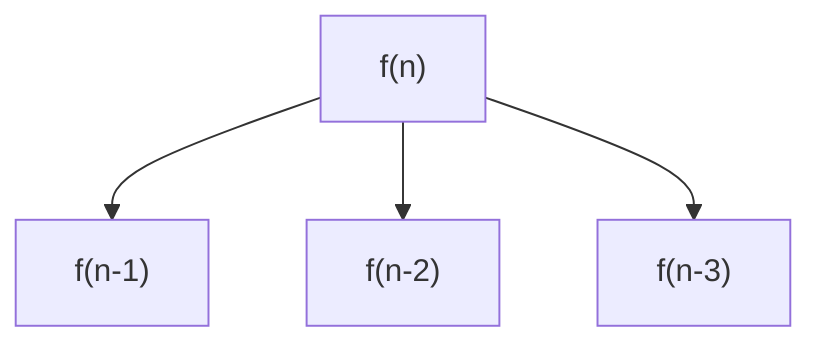

To see how recursion calls are traced, refer [VisuAlgo](https://visualgo.net/en/recursion)
and [this example](/code-journal/dsa/dsa/recursion/4-recurrence-master-thm#tracing-recursion-calls)

## 1. Tail Recursion

- The recursive call is the **last step** in the function body. No operation is to be done after it
- These can be **easily optimized into loops** to save call stack memory

```cpp title="Tail Recursion"
void func(int n) {
    if (n > 0) {
        cout << n << "\n";
        func(n - 1);        // Recursive call
    }
}
```

If it had something like `func(n-1) + 1`, it wouldn't be tail recursion as there is some extra operation after the recursive call. The above tail-recursive function can be converted into iterative one as:

```cpp title="Iterative version of Tail Recursion"
void func(int n) {
    while (n > 0) {
        cout << n << "\n";
        n--;
    }
}
```

## 2. Head Recursion

- The recursive call is the **first step** in the function body

```cpp title="Head Recursion"
void func(int n) {
    if (n > 0) {
        func(n - 1);        // Recursive call
        cout << n << "\n";
    }
}
```

The iterative version of above code would be:

```cpp title="Iterative version of Head Recursion"
void func(int n) {
    int i = 0;
    while (i < n) {
        cout << i << "\n";
        i++;
    }
}
```

So, it's not as easy to convert into iterative solution as Tail recursion. Quite some modifications need to be made.

Recursion in which there's a **single recursive call per input** is called **Linear Recursion**

## 3. Tree Recursion

There can be **multiple recursive calls (branching) per input**. These are typically called Tree Recursion

```cpp
void func(int n) {
    if (n > 3) {
        cout << n << "\n";
        func(n - 1);        // Recursive call
        func(n - 2);        // Recursive call
        func(n - 3);        // Recursive call
    }
}
```



## 4. Indirect Recursion

There may be more than one function and they are calling one another in a circular manner

```cpp
// Functions declarations (to avoid not-found error)
void F1(int n);
void F2(int n);

void F1() {
    if (n > 0) {
        cout << n << "\n";
        F2(n - 1);
    }
}

void F2() {
    if (n > 0) {
        cout << n << "\n";
        F1(n / 2);
    }
}
```

## 5. Nested Recursion

The recursive call is nested inside another call

```cpp
void func() {
    if (n > 0) {
        cout << n << "\n";
        func(func(n - 1));  // Nested Recursive call
    }
}
```
